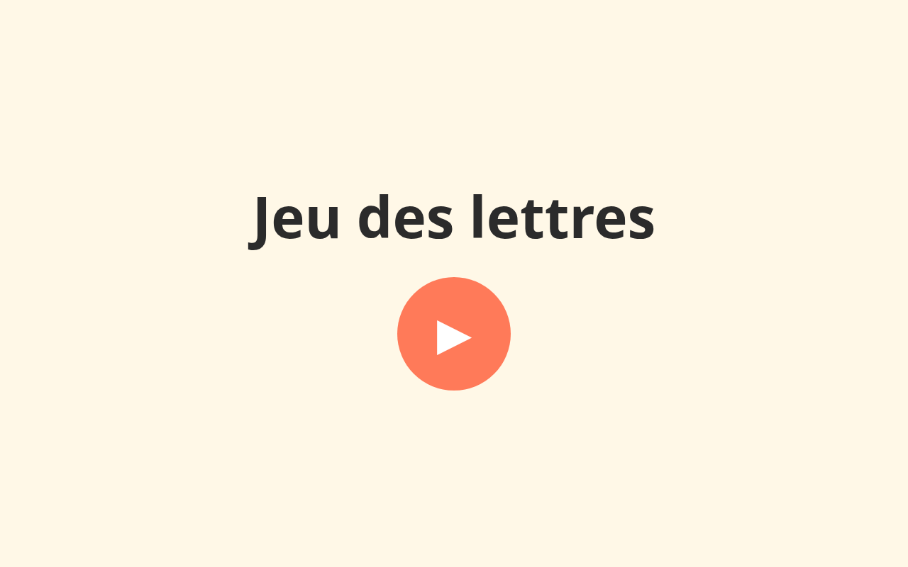
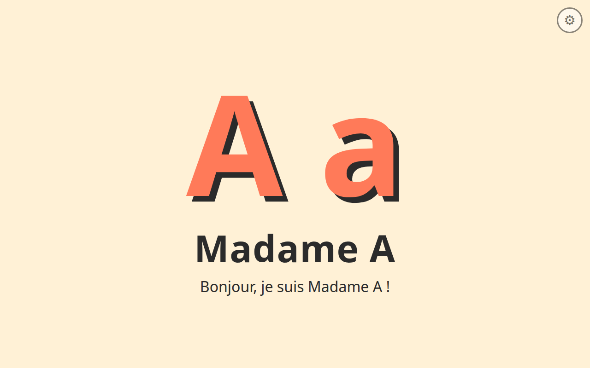
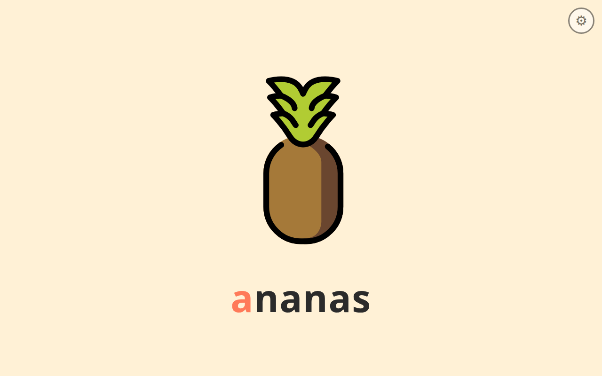

# alphabetGame

**A keyboard game that helps young children meet the letters of the alphabet.**
Each key a child presses brings up a friendly letter character, a picture and a spoken word.
It is a free, non-profit hobby project, with no ads, no tracking and no accounts.

<p align="center">
  
  
  
</p>

> **Status:** 🇫🇷 French is playable. 🇭🇷 Croatian and 🇬🇧 English come next.

## How it plays

1. Press **▶** to start. The game goes full screen, so the child can't wander off.
2. Press a letter key. The **letter's character** appears and introduces itself
   (_« Bonjour, je suis Madame A ! »_).
3. Press the same letter again to cycle through **three picture words**, each one spoken aloud
   (_ananas, avion, abeille…_). The word's first letter is highlighted.
4. Keys with no good word (accents, digits…) play a **funny sound** instead: boing, pop, whistle… or a fart.
5. Keys mashed while a word is still playing are ignored, so every sound finishes.
6. To leave the game, a grown-up **holds the ⚙ button for 3 seconds**.

The letter characters ("Madame A", "Monsieur I grec") borrow a classroom idea used in French
_maternelle_, where each letter is a little person. All names, lines and drawings here are our own.

## Try it locally

You need Node (version in `.nvmrc`), Python 3.12 and [uv](https://docs.astral.sh/uv/).

```sh
npm ci
./scripts/play.sh            # builds once, then opens http://127.0.0.1:8080
./scripts/play.sh --rebuild  # rebuild after changes
```

The game runs only while `play.sh` is running. Press Ctrl+C to stop it.

## Features

- **One pack per language.** Words, characters, voices and UI text live in data files.
  Adding a language means adding data, with no code changes.
- **Pictures shared across languages.** A concept such as _pineapple_ has one picture, used by
  FR _ananas_, HR _ananas_ and EN _pineapple_.
- **Free offline speech.** Audio is generated at build time with [Piper](https://github.com/OHF-Voice/piper1-gpl).
  Croatian is recorded by hand with a small local recorder tool.
- **Licensed pictures only.** Every image has a provenance record and a review before it ships.
- **Built for more games.** The keyboard game is one module, and new games such as "find the first
  letter" or drag and drop plug into the same core.

## Privacy and security

This site is for children, so it is locked down:

- A fully static site: no backend, no cookies, no analytics and no third-party requests.
- A strict Content Security Policy with no inline scripts and no `eval`, plus `frame-ancestors 'none'`,
  `nosniff` and `no-referrer`.
- Content is only ever rendered as text. HTML injection is banned by lint rules.
- All content is schema-validated at build time, and SVGs are checked for scripts and external references.
- Dependencies are pinned and audited (`npm audit`, `pip-audit`). CI actions are pinned to commit SHAs.
  A gitleaks pre-commit hook guards against leaked secrets.

The threat model is in [SECURITY.md](SECURITY.md).

## Project layout

```
src/
  app/        start screen, game registry
  games/      one folder per game (smash = the keyboard game)
  ui/         shared Svelte components
  core/       plain TypeScript: content loading, audio, input, input lock, i18n
content/
  concepts/   language-neutral things and their pictures
  languages/  fr/ hr/ en/ _template/: words, characters, UI text, audio
  images/     pictures + license manifest
  schemas/    JSON Schemas: the single source of truth for the data
tools/        Python build tools: validation, speech, picture import, recorder
tests/        Vitest unit tests + Playwright end-to-end tests
```

Layers only depend downward (`app → games → ui → core`), and ESLint enforces this.

## Development

```sh
npm run dev        # dev server with hot reload
npm run verify     # content build, format, lint, typecheck, unit tests, build
npm run test:e2e   # Playwright against the production build
cd tools && uv run pytest
```

**Stack:** Svelte 5, TypeScript (strict), Vite, Vitest, Playwright, Python 3.12 with uv.

The project is developed with help from AI coding agents. Their roles and rules are in
[`CLAUDE.md`](CLAUDE.md) and [`.claude/`](.claude/).

## Credits

- Pictures: [OpenMoji](https://openmoji.org), licensed CC BY-SA 4.0.
- French voice: Piper `fr_FR-siwis-medium`, licensed CC BY 4.0.
- Fun sounds: synthesized for this project.

The full list is in [content/CREDITS.md](content/CREDITS.md).
